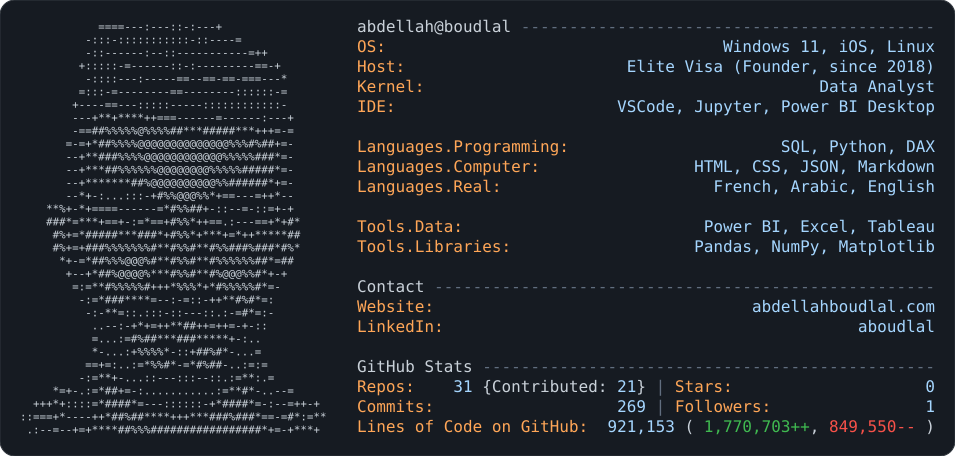

<a href="https://github.com/aboudlal">
  <picture>
    <source media="(prefers-color-scheme: dark)" srcset="dark_mode.svg">
    <source media="(prefers-color-scheme: light)" srcset="light_mode.svg">
    
  </picture>
</a>

<details>
<summary>Text version</summary>

<!-- PROFILE:START -->
```text
        =---::::::::::-=+               abdellah@boudlal -------------------------------------------
       +::::--:::::--------=+           OS:                                   Windows 11, iOS, Linux
       =::::----------------=-=         Host:                       Elite Visa (Founder, since 2018)
       -:---:::::-----:::::::::=        Kernel:                                         Data Analyst
      --=****#*++==---===-------        IDE:                       VSCode, Jupyter, Power BI Desktop
      -=*##%%%@@@@@@%%%%%%%###+-
     --+*###%%%@@@@@@@@%%%%###*=        Languages.Programming:                      SQL, Python, DAX
      -+++++++*%%@@@@@@%#####*+-        Languages.Computer:                HTML, CSS, JSON, Markdown
    **-*=----::-=#%%%*=:::--:=+-        Languages.Real:                      French, Arabic, English
    #*=*#*+++=**++%%*+++--==++**#
    #*=*##%%%%%%**#%#*#%%##%##+%#       Tools.Data:                         Power BI, Excel, Tableau
     +-=*#%%@@%#**#%#*#%@@%%#*-+        Tools.Libraries:                   Pandas, NumPy, Matplotlib
       -=*#%###+===*+-+*##%#*-
        ::++---:---==--::-*+:-          Contact ----------------------------------------------------
         ...-#%#*********-:.-           Website:                                 abdellahboudlal.com
        +=:..-*%%#=-*#%#-..-=           LinkedIn:                                           aboudlal
      +::**=:..::::.:::.:=*+.:=
  +++-::-*###+=-:::::-=+###*-::-+==*    GitHub Stats -----------------------------------------------
-.--=-==+**##%%#############*+==*=*+    Repos:    31 {Contributed: 21} | Stars:                    0
                                        Commits:                   274 | Followers:                1
                                        Lines of Code on GitHub:  921,290 ( 1,770,889++, 849,599-- )
```
<!-- PROFILE:END -->

</details>
